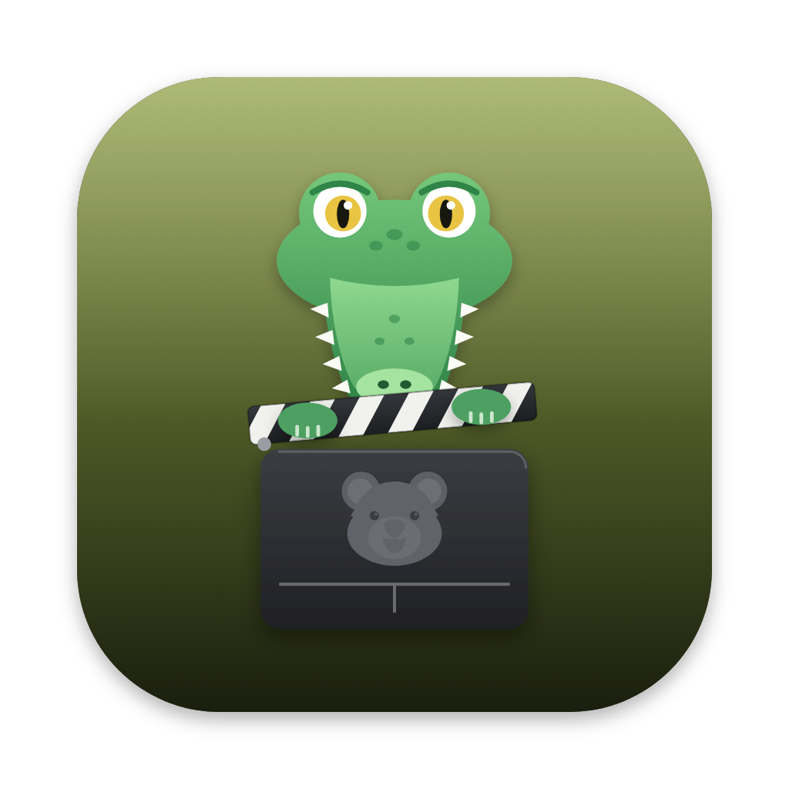

<p align="center">
  
</p>

<h1 align="center">Croc</h1>

<p align="center">
  A small native macOS app that chews big videos down to size for the web.
</p>

<p align="center">
  <a href="https://github.com/kimiyuch/croc.app/releases/latest/download/Croc.dmg"><b>Download Croc</b></a>
  ·
  <a href="https://croc.kimiyu.ch">Website</a>
</p>

---

## Features

- Drop MOV and MP4 files (or a folder of them) on the window or the Dock icon; they're converted one after the other
- Three formats:
  - **Web MP4**: H.264 + AAC with `faststart`, plays in every browser and starts before it has fully loaded
  - **WebM**: VP9 + Opus, smaller files, slower to make
  - **Silent loop**: H.264 without sound, for background and hero videos
- Size limit (720p, 1080p, 1440p or the original size) on the short side, so portrait videos work the same; never upscales
- Three quality steps (Smaller, Balanced, Better)
- HDR videos from the iPhone are tone-mapped to normal colours, so they don't look grey in the browser
- Saves next to the original (`clip.mov` → `clip.web.mp4`, `clip.webm`, `clip.loop.mp4`) or in a folder you pick, and never overwrites anything
- Shows each video's progress and how much smaller it got; nothing leaves your Mac

## Build

```bash
cd croc.app
./build.sh
```

Requires macOS 14+ on Apple Silicon and Xcode (or the Command Line Tools). `build.sh` first downloads ffmpeg (see below),
then builds `build/Croc.app`.

## Release

```bash
./make-dmg.sh       # build/Croc.dmg
./release.sh 0.1    # notes from CHANGELOG.md; bumps Info.plist, tags, creates the GitHub release
```

`release.sh` needs a `## 0.1 (date)` section in `CHANGELOG.md`, a clean git tree and the GitHub CLI. It attaches `Croc.dmg`
and `CHANGELOG.md` to the release; the website reads its changelog from there.

## ffmpeg

Croc bundles a static arm64 build of [FFmpeg](https://ffmpeg.org) 9.0.2 by [Martin Riedl](https://ffmpeg.martin-riedl.de)
(GPLv3, with libx264, libvpx and libopus). `scripts/fetch-ffmpeg.sh` downloads it into `Resources/bin` and checks its SHA-256;
`build.sh` copies it into the app next to Croc. Its source is at [ffmpeg.org](https://ffmpeg.org/download.html) and the build
scripts at [gitlab.com/martinr92/ffmpeg](https://gitlab.com/martinr92/ffmpeg). Video details (length, size, HDR) are read with
AVFoundation, so ffprobe isn't needed.

## Files

- `Sources/Croc/CrocApp.swift` — the app, menu commands and open panels
- `Sources/Croc/Views.swift` — the window: format cards, settings, drop zone and the list of videos
- `Sources/Croc/Converter.swift` — the list of videos and converting them one at a time
- `Sources/Croc/Presets.swift` — formats, sizes and quality, and the ffmpeg command line built from them
- `Sources/Croc/Encoder.swift` — reading a video with AVFoundation and running ffmpeg with progress
- `Sources/Croc/Theme.swift` — colours, Figtree and button styles, matching croc.kimiyu.ch
- `scripts/make-icon.mjs` — draws the icon (`node scripts/make-icon.mjs`, needs Google Chrome)
- `Resources/Fonts` — Figtree (SIL Open Font License, see `OFL.txt`)

## License

Croc is free software under the [GNU General Public License v3](LICENSE). It bundles FFmpeg (GPLv3, see above) and the
Figtree font, which is under the [SIL Open Font License](Resources/Fonts/OFL.txt).
